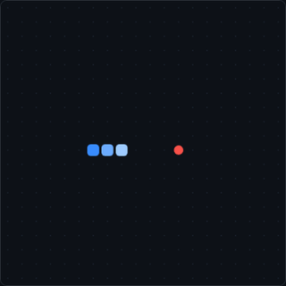

# Jogo da cobrinha

  

Jogo da cobrinha feito com HTML, CSS e JavaScript puro, sem bibliotecas. Roda direto no navegador, no computador ou no celular.

**[▶ Jogar agora](https://gramacho05.github.io/jogo-da-cobrinha/)**

## Como jogar

- Mova a cobrinha com as **setas** ou as teclas **W A S D**.
- Coma as bolinhas vermelhas para ganhar pontos e fazer a cobrinha crescer.
- Não bata nas paredes nem no próprio corpo.
- **Espaço** pausa e continua o jogo, e reinicia depois do fim de jogo.
- No celular, **deslize o dedo** na tela ou use os botões de direção.

## Recursos

- Pontuação e recorde, com o recorde salvo no navegador.
- A velocidade aumenta conforme a pontuação, com um limite máximo.
- Pausa, reinício rápido e mensagens de fim de jogo.
- Layout adaptado para celular.

## Como funciona

- O tabuleiro tem 20 x 20 casas e é desenhado em um `<canvas>`.
- O jogo anda em passos de tempo (ticks). A cada passo, a cobrinha avança uma casa, e o programa confere se ela bateu, se comeu ou se continua livre.
- As teclas pressionadas entram numa pequena fila, para não perder um comando quando você aperta duas setas rápido, e a cobrinha não consegue inverter de direção na hora.
- A nova comida sempre nasce em uma casa livre.

## Tecnologias

HTML5, CSS3 e JavaScript (Canvas).

## Como rodar no seu computador

Baixe o arquivo `index.html` e abra no navegador. Não precisa instalar nada.

## Autor

Gabriel Braes Gramacho · [LinkedIn](https://www.linkedin.com/in/gabriel-braes-gramacho-3a6191403/)
